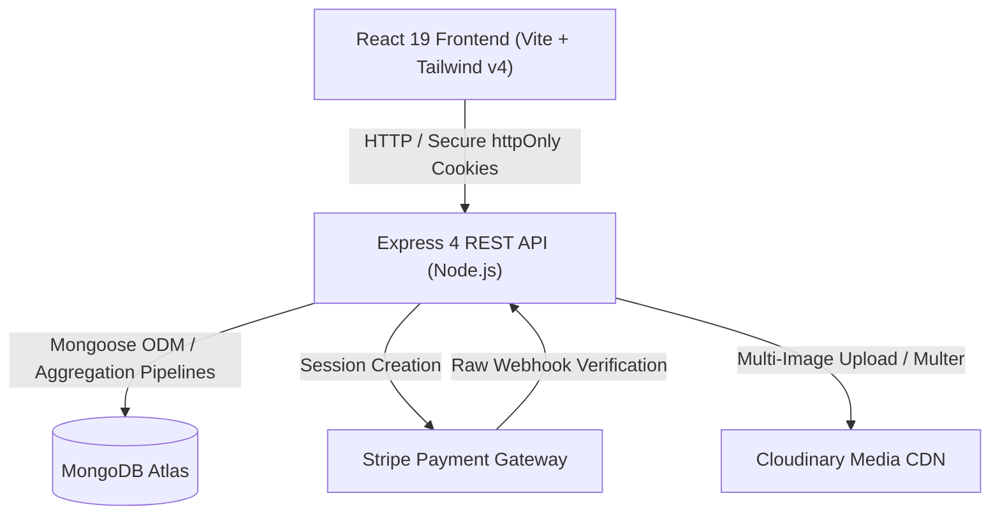

# 🛒 GreenCart — Full-Stack Scalable E-Commerce Platform

[](https://react.dev/)
[](https://nodejs.org/)
[](https://expressjs.com/)
[](https://www.mongodb.com/)
[](https://tailwindcss.com/)
[](https://stripe.com/)
[](https://cloudinary.com/)

> A production-ready, full-stack grocery e-commerce platform engineered for performance, security, and scalability. Built with a decoupled client-server architecture featuring server-side pagination, atomic cart management, Stripe checkout with webhook reconciliation, and a dedicated seller operations portal.

---

## 🌐 Live Demo & Deployment

- **Live Storefront:** [https://green-cart-web-sable.vercel.app](https://green-cart-web-sable.vercel.app)
- **Architecture:** Monorepo with independent frontend (`client/`) and serverless backend (`server/`) deployed on Vercel.

---

## 🏗️ Architecture & Data Flow



---

## ⚡ Key Engineering Highlights

### 1. Server-Side Pagination & Faceted Aggregation
- **High-Performance MongoDB Pipelines:** Utilizes `$facet` to perform pagination (`$skip`, `$limit`) and total document counts in a **single database trip**, avoiding redundant queries.
- **Dynamic Multi-Field Filtering:** Supports composite query filters (`search`, `category`, `inStock`) using case-insensitive regex without memory overhead on the client.

### 2. Accessible Sliding-Window Pagination Component
- **Accessible & SEO Compliant:** Encapsulated in semantic `<nav>` with full WAI-ARIA support (`aria-label`, `aria-current`, `aria-disabled`).
- **URL Synchronization:** Integrates with `useSearchParams` and `useLocation` to preserve bookmarkable search queries across page transitions.
- **Euclidean Sliding Window:** Intelligently adapts display (`[1, ...?, prev, current, next, ...?, totalPages]`) based on total page thresholds.

### 3. Zero-Trust Cart & Checkout Pipeline
- **Single Source of Truth:** Avoids stale client snapshots by persisting lightweight references (`{ productId: quantity }`) and populating real-time prices directly from the database upon cart inspection.
- **Server-Side Price Validation:** Final charge calculations are strictly calculated on the server to prevent client-side price tampering.
- **Stripe Webhook Reconciliation:** Implements raw request verification to guarantee order fulfillment and automatic cart clearance upon `payment_intent.succeeded`.

### 4. Dual-Role Authentication & Security
- **Role-Based Access Control (RBAC):** Distinct authentication flows for Customers and Store Administrators using signed JWTs.
- **XSS & CSRF Defense:** Auth tokens are stored strictly in `httpOnly`, `SameSite`, and `Secure` cookies—zero token leakage to `localStorage`.

---

## 🧰 Tech Stack

| Layer | Technologies |
|---|---|
| **Frontend** | React 19, React Router v7, Tailwind CSS v4, Axios, React Hot Toast, Vite |
| **Backend** | Node.js, Express.js 4, Mongoose 8 (MongoDB), Multer, Cookie-Parser, CORS |
| **Authentication** | JWT (`jsonwebtoken`), bcryptjs (10 rounds), httpOnly Cookies |
| **Payments** | Stripe API (Checkout Sessions & Webhook Signatures) |
| **Media & Assets** | Cloudinary v2 SDK, Multer disk storage |
| **Deployment** | Vercel (Client SPA rewrite + Serverless Express runtime) |

---

## 📁 Repository Structure

```
GreenCart/
├── client/                     # Frontend Application
│   ├── src/
│   │   ├── assets/             # SVGs, category presets, branding assets
│   │   ├── components/         # Reusable UI (Navbar, ProductCard, Pagination, etc.)
│   │   │   └── seller/         # Admin components (SellerLogin, etc.)
│   │   ├── context/            # Global AppContext (User auth, Cart controls)
│   │   ├── pages/              # Client routes (Home, AllProducts, ProductCategory, Cart, etc.)
│   │   │   └── seller/         # Admin views (AddProduct, ProductList, Orders)
│   │   ├── App.jsx             # Route definitions & layout wrappers
│   │   └── main.jsx            # Entry point & provider bootstrapping
│   └── package.json
│
├── server/                     # Backend Application
│   ├── configs/                # MongoDB, Cloudinary, Multer configurations
│   ├── controllers/            # Request handlers (product, cart, order, user, seller)
│   ├── middlewares/            # authUser, authSeller JWT verification guards
│   ├── models/                 # Mongoose schemas (User, Product, Order, Address)
│   ├── routes/                 # Express API routes
│   ├── server.js               # Express app bootstrap & middleware pipeline
│   └── package.json
│
├── analysis.md                 # Complete system analysis & architecture documentation
└── README.md
```

---

## 🔌 API Reference

### Products (`/api/product`)
- `GET /api/product/list?page=1&limit=10&search=milk&category=dairy&inStock=true` — Paginated product catalog.
- `GET /api/product/:id` — Single product details.
- `POST /api/product/add` — Create product with Cloudinary images (`authSeller`).
- `POST /api/product/stock` — Toggle product stock status (`authSeller`).

### Cart & Orders (`/api/cart`, `/api/order`)
- `POST /api/cart/items` — Fetch populated product metadata for active cart IDs.
- `POST /api/cart/update` — Synchronize cart state to user document (`authUser`).
- `POST /api/order/cod` — Place Cash On Delivery order (`authUser`).
- `POST /api/order/stripe` — Initiate Stripe Checkout session (`authUser`).
- `POST /stripe` — Stripe webhook listener (processes payment intents).

### Authentication (`/api/user`, `/api/seller`)
- `POST /api/user/register` & `POST /api/user/login` — User authentication.
- `GET /api/user/is-auth` & `GET /api/user/logout` — Session management.
- `POST /api/seller/login` — Administrator credentials verification.

---

## 🚀 Getting Started Locally

### Prerequisites
- Node.js (v18+)
- MongoDB Atlas cluster or local MongoDB instance
- Cloudinary and Stripe accounts

### 1. Clone the repository
```bash
git clone https://github.com/your-username/GreenCart.git
cd GreenCart
```

### 2. Configure Backend Environment
Create `server/.env`:
```env
PORT=4000
MONGODB_URI=your_mongodb_connection_string
JWT_SECRET=your_jwt_secret_key
SELLER_EMAIL=admin@greencart.com
SELLER_PASSWORD=your_admin_password
CLOUDINARY_CLOUD_NAME=your_cloudinary_name
CLOUDINARY_API_KEY=your_cloudinary_key
CLOUDINARY_API_SECRET=your_cloudinary_secret
STRIPE_SECRET_KEY=your_stripe_secret_key
STRIPE_WEBHOOK_SECRET=your_stripe_webhook_secret
NODE_ENV=development
```

### 3. Configure Frontend Environment
Create `client/.env`:
```env
VITE_CURRENCY=$
VITE_BACKEND_URL=http://localhost:4000
```

### 4. Install Dependencies & Run

```bash
# Terminal 1: Start Server
cd server
npm install
node server.js

# Terminal 2: Start Client
cd client
npm install
npm run dev
```

---

## 🔮 Future Roadmap

- [ ] **Ghost Mode (Guest Checkout & Cart Migration):** Enable unauthenticated guest carts with seamless client-to-server cart merging upon login or registration.
- [ ] **AI Shopping Assistant:** Intelligent conversational agent for natural-language product search, smart dietary substitutions, and recipe-based cart creation.
- [ ] **Live Inventory WebSockets:** Real-time stock alerts and notification badges when items are running low.
- [ ] **Order Tracking Dashboard:** Real-time step-by-step dispatch tracking for buyers.

---

## 📄 License

This project is licensed under the [MIT License](LICENSE).
