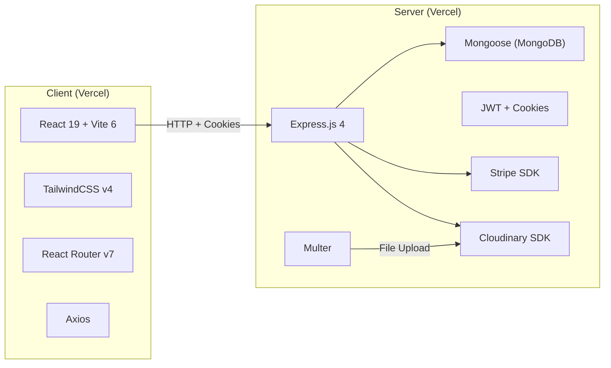
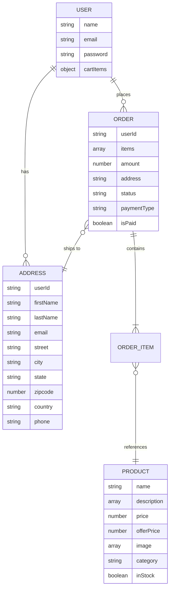
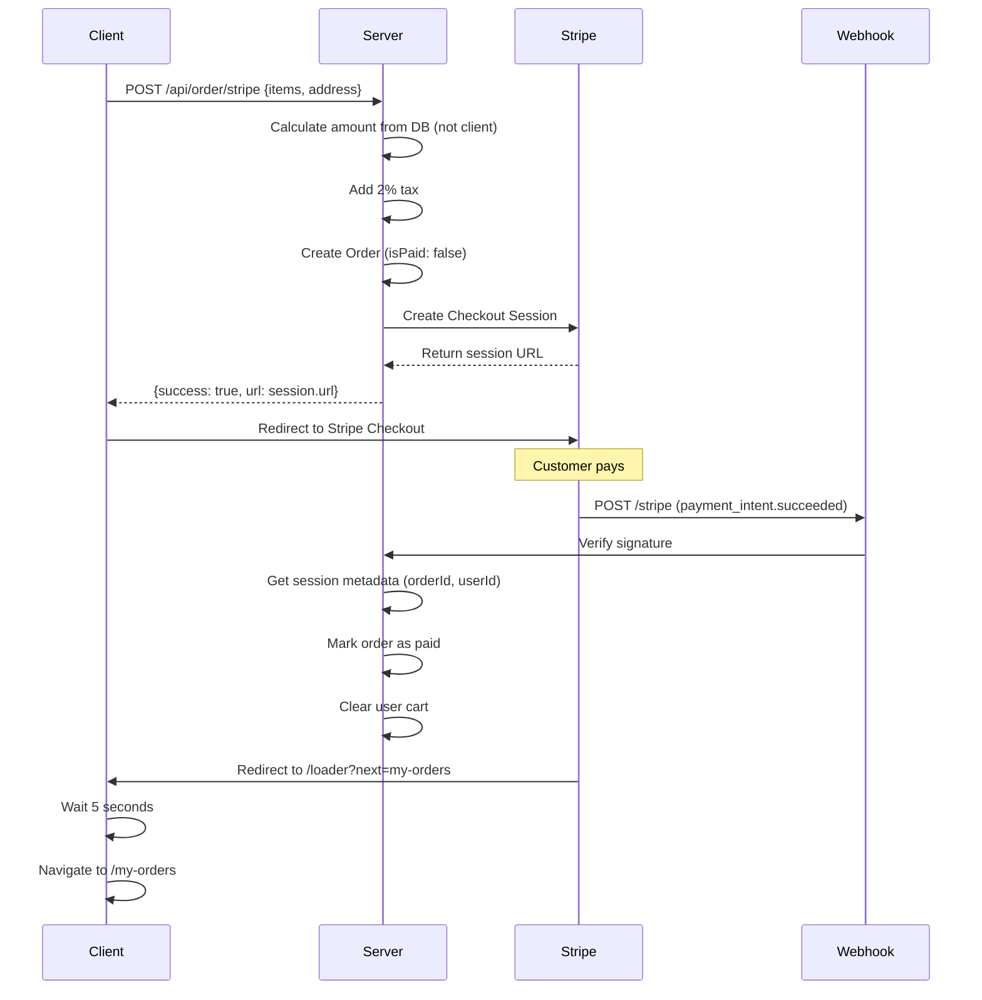
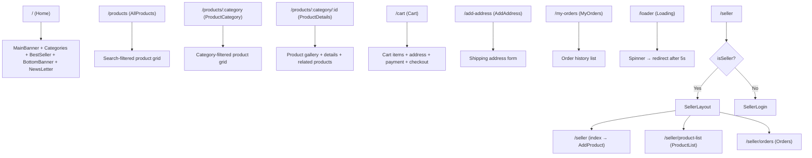

# 🟢 GreenCart — Complete Project Analysis (0 → 1)

> **Analyzed on:** 2026-10-07  
> **Repository:** `c:\Users\mirro\Desktop\Project Sundar\Madigineer\GreenCart`  
> **Git commits (6 total):** `947713e` → `a9fa4ca`

---

## Table of Contents

1. [Project Overview](#1-project-overview)
2. [Architecture & Tech Stack](#2-architecture--tech-stack)
3. [Folder Structure Map](#3-folder-structure-map)
4. [Environment Variables & Secrets](#4-environment-variables--secrets)
5. [Database Schema (MongoDB)](#5-database-schema-mongodb)
6. [Backend — Full Breakdown](#6-backend--full-breakdown)
7. [Frontend — Full Breakdown](#7-frontend--full-breakdown)
8. [Authentication System](#8-authentication-system)
9. [Payment System (Stripe)](#9-payment-system-stripe)
10. [Cart System](#10-cart-system)
11. [API Reference (All Endpoints)](#11-api-reference-all-endpoints)
12. [Client Routing Map](#12-client-routing-map)
13. [State Management (Context)](#13-state-management-context)
14. [Assets & Dummy Data](#14-assets--dummy-data)
15. [Deployment Configuration](#15-deployment-configuration)
16. [Known Bugs & Issues](#16-known-bugs--issues)
17. [Security Analysis](#17-security-analysis)
18. [Missing Features & Future Dev Opportunities](#18-missing-features--future-dev-opportunities)

---

## 1. Project Overview

**GreenCart** is a full-stack **online grocery e-commerce application** built with a React frontend and Node.js/Express backend. It allows:

- **Customers** to browse, search, and purchase grocery products (vegetables, fruits, dairy, drinks, bakery, grains, instant food) via **Cash on Delivery (COD)** or **Stripe online payments**.
- **A single seller/admin** to log in with hardcoded credentials, add products (with images uploaded to Cloudinary), manage stock, and view all orders.

The project is structured as a **monorepo** with two independent apps (`client/` and `server/`), each deployable separately to **Vercel**.

**Live Production URL (configured):** `https://green-cart-web-sable.vercel.app`

---

## 2. Architecture & Tech Stack

### High-Level Architecture



### Frontend Stack
| Technology | Version | Purpose |
|---|---|---|
| React | 19.0.0 | UI Framework |
| React DOM | 19.0.0 | DOM Rendering |
| React Router DOM | 7.4.0 | Client-side routing |
| TailwindCSS | 4.0.17 | Utility-first CSS |
| @tailwindcss/vite | 4.0.16 | Tailwind Vite plugin |
| Axios | 1.8.4 | HTTP client |
| React Hot Toast | 2.5.2 | Toast notifications |
| Vite | 6.2.0 | Build tool & dev server |
| @vitejs/plugin-react | 4.3.4 | React Fast Refresh |

### Backend Stack
| Technology | Version | Purpose |
|---|---|---|
| Express | 4.21.2 | HTTP framework |
| Mongoose | 8.13.1 | MongoDB ODM |
| bcryptjs | 3.0.2 | Password hashing |
| jsonwebtoken | 9.0.2 | JWT authentication |
| cookie-parser | 1.4.7 | Cookie parsing middleware |
| cors | 2.8.5 | Cross-origin requests |
| dotenv | 16.4.7 | Environment variables |
| cloudinary | 2.6.0 | Image hosting CDN |
| multer | 1.4.5-lts.2 | File upload handling |
| stripe | 17.7.0 | Payment processing |
| nodemon | 3.1.9 | Dev auto-restart (devDep) |

### Key Design Decisions
- **ES Modules** (`"type": "module"`) used in both client and server
- **Cookie-based auth** (httpOnly cookies) — no localStorage tokens
- **Top-level await** in `server.js` for DB/Cloudinary connection
- **Single seller model** — admin credentials are environment variables, not a DB model
- **Cart stored in User model** — `cartItems` is an `Object` field on the User document, synced via API on every change
- **Font:** Google Fonts "Outfit" (weights 100–900)
- **Color system:** Primary `#4fbf8b` (green), Primary-dull `#44ae7c`

---

## 3. Folder Structure Map

```
GreenCart/
├── .git/
├── README.md                        # Recruiter-friendly documentation
├── analysis.md                      # System architectural breakdown
├── client/                          # React Frontend
│   ├── .env                         # VITE_CURRENCY, VITE_BACKEND_URL
│   ├── .gitignore
│   ├── eslint.config.js             # ESLint flat config
│   ├── index.html                   # SPA entry, title: "GreenCart - GreatStack"
│   ├── package.json
│   ├── package-lock.json
│   ├── vercel.json                  # SPA rewrite rule
│   ├── vite.config.js               # React + Tailwind plugins
│   ├── public/                      # (empty — favicon is in src/assets)
│   └── src/
│       ├── main.jsx                 # App entry → BrowserRouter + Context
│       ├── App.jsx                  # Root component with routes
│       ├── index.css                # Outfit font + Tailwind import + theme
│       ├── assets/
│       │   ├── assets.js            # 844 lines — exports, dummy data, categories
│       │   ├── *.svg                # Icons (logo, cart, search, arrows, etc.)
│       │   └── *.png                # Product images, banners, profile icon
│       ├── context/
│       │   └── AppContext.jsx       # Global state (user, cart, products, seller)
│       ├── components/
│       │   ├── BestSeller.jsx       # Top 5 in-stock products
│       │   ├── BottomBanner.jsx     # "Why We Are the Best?" features section
│       │   ├── Categories.jsx       # 7 category grid with navigation
│       │   ├── Footer.jsx           # Logo, description, footer links
│       │   ├── Loading.jsx          # Spinner + redirect after 5 seconds
│       │   ├── Login.jsx            # User login/register modal overlay
│       │   ├── MainBanner.jsx       # Hero banner with CTAs
│       │   ├── Navbar.jsx           # Top nav: logo, links, search, cart, auth
│       │   ├── NewsLetter.jsx       # Email subscription form (UI only)
│       │   ├── Pagination.jsx       # Accessible, URL-synced pagination navigation
│       │   ├── ProductCard.jsx      # Product card with add-to-cart controls
│       │   └── seller/
│       │       └── SellerLogin.jsx  # Seller login form
│       └── pages/
│           ├── AddAddress.jsx       # Shipping address form
│           ├── AllProducts.jsx      # All products with search filter
│           ├── Cart.jsx             # Cart, address selection, payment, checkout
│           ├── Home.jsx             # Landing page composition
│           ├── MyOrders.jsx         # User order history
│           ├── ProductCategory.jsx  # Products filtered by category
│           ├── ProductDetails.jsx   # Single product with gallery + related
│           └── seller/
│               ├── AddProduct.jsx   # Product creation form (up to 4 images)
│               ├── Orders.jsx       # All orders view for seller
│               ├── ProductList.jsx  # All products with stock toggle
│               └── SellerLayout.jsx # Seller dashboard shell (navbar + sidebar)
│
└── server/                          # Express Backend
    ├── .gitignore                   # node_modules, .env
    ├── package.json
    ├── package-lock.json
    ├── server.js                    # Entry point — Express app setup
    ├── vercel.json                  # Vercel serverless config
    ├── configs/
    │   ├── db.js                    # MongoDB connection via Mongoose
    │   ├── cloudinary.js            # Cloudinary v2 configuration
    │   └── multer.js                # Multer with disk storage
    ├── controllers/
    │   ├── addressController.js     # addAddress, getAddress
    │   ├── cartController.js        # updateCart
    │   ├── orderController.js       # COD, Stripe, webhooks, user/seller orders
    │   ├── productController.js     # add, list, getById, changeStock
    │   ├── sellerController.js      # login, isAuth, logout (env-based)
    │   └── userController.js        # register, login, isAuth, logout
    ├── middlewares/
    │   ├── authUser.js              # JWT verify from "token" cookie → userId
    │   └── authSeller.js            # JWT verify from "sellerToken" cookie
    ├── models/
    │   ├── Address.js               # userId, firstName, lastName, email, street, city, state, zipcode, country, phone
    │   ├── Order.js                 # userId, items[], amount, address, status, paymentType, isPaid
    │   ├── Product.js               # name, description[], price, offerPrice, image[], category, inStock
    │   └── User.js                  # name, email, password, cartItems{}
    └── routes/
        ├── addressRoute.js          # POST /add, GET /get
        ├── cartRoute.js             # POST /update, POST /items
        ├── orderRoute.js            # POST /cod, GET /user, GET /seller, POST /stripe
        ├── productRoute.js          # POST /add, GET /list, GET /:id, POST /stock
        ├── sellerRoute.js           # POST /login, GET /is-auth, GET /logout
        └── userRoute.js             # POST /register, POST /login, GET /is-auth, GET /logout
```

---

## 4. Environment Variables & Secrets

### Client `.env` (committed to repo!)
```env
VITE_CURRENCY = '$'
VITE_BACKEND_URL = "http://localhost:4000"
```

### Server `.env` (gitignored — required variables):
| Variable | Purpose | Used In |
|---|---|---|
| `MONGODB_URI` | MongoDB Atlas connection string | `configs/db.js` |
| `JWT_SECRET` | Secret key for JWT sign/verify | `authUser.js`, `authSeller.js`, `userController.js`, `sellerController.js` |
| `SELLER_EMAIL` | Hardcoded admin email | `sellerController.js`, `authSeller.js` |
| `SELLER_PASSWORD` | Hardcoded admin password | `sellerController.js` |
| `CLOUDINARY_CLOUD_NAME` | Cloudinary account name | `configs/cloudinary.js` |
| `CLOUDINARY_API_KEY` | Cloudinary API key | `configs/cloudinary.js` |
| `CLOUDINARY_API_SECRET` | Cloudinary API secret | `configs/cloudinary.js` |
| `STRIPE_SECRET_KEY` | Stripe secret API key | `orderController.js` |
| `STRIPE_WEBHOOK_SECRET` | Stripe webhook signing secret | `orderController.js` |
| `NODE_ENV` | `production` or `development` | Cookie settings in all auth controllers |
| `PORT` | Server port (default: 4000) | `server.js` |

> [!WARNING]
> The client `.env` is **committed to the repository**. While it only contains non-sensitive values (currency symbol and localhost URL), this is still a bad practice. The `VITE_BACKEND_URL` needs to be changed for production — the Vercel deployment likely uses an environment variable override.

---

## 5. Database Schema (MongoDB)

Database name: **`greencart`** (hardcoded in connection string: `${MONGODB_URI}/greencart`)

### User Model
```javascript
// Collection: "users"
{
    name:      { type: String, required: true },
    email:     { type: String, required: true, unique: true },
    password:  { type: String, required: true },  // bcrypt hash (10 rounds)
    cartItems: { type: Object, default: {} },      // { productId: quantity }
}
// Options: { minimize: false } — preserves empty objects in MongoDB
```

### Product Model
```javascript
// Collection: "products"
{
    name:        { type: String, required: true },
    description: { type: Array, required: true },    // Array of strings (bullet points)
    price:       { type: Number, required: true },   // Original MRP
    offerPrice:  { type: Number, required: true },   // Discounted price
    image:       { type: Array, required: true },    // Array of Cloudinary URLs
    category:    { type: String, required: true },   // "Vegetables", "Fruits", etc.
    inStock:     { type: Boolean, default: true },
}
// Options: { timestamps: true } — adds createdAt, updatedAt
```

### Order Model
```javascript
// Collection: "orders"
{
    userId:      { type: String, required: true, ref: 'user' },
    items: [{
        product:  { type: String, required: true, ref: 'product' },
        quantity: { type: Number, required: true }
    }],
    amount:      { type: Number, required: true },   // Total with 2% tax
    address:     { type: String, required: true, ref: 'address' },
    status:      { type: String, default: 'Order Placed' },
    paymentType: { type: String, required: true },   // "COD" or "Online"
    isPaid:      { type: Boolean, required: true, default: false },
}
// Options: { timestamps: true }
```

### Address Model
```javascript
// Collection: "addresses"
{
    userId:    { type: String, required: true },
    firstName: { type: String, required: true },
    lastName:  { type: String, required: true },
    email:     { type: String, required: true },
    street:    { type: String, required: true },
    city:      { type: String, required: true },
    state:     { type: String, required: true },
    zipcode:   { type: Number, required: true },
    country:   { type: String, required: true },
    phone:     { type: String, required: true },
}
// No timestamps
```

### Entity Relationship



---

## 6. Backend — Full Breakdown

### 6.1 Entry Point — [server.js](file:///c:/Users/mirro/Desktop/Project%20Sundar/Madigineer/GreenCart/server/server.js)

**Execution order matters:**
1. Top-level `await connectDB()` and `await connectCloudinary()`
2. **Stripe webhook route** registered **BEFORE** `express.json()` middleware — this is critical because Stripe webhooks need the raw body
3. Standard middleware: `express.json()`, `cookieParser()`, `cors()`
4. API routes mounted under `/api/*`

**CORS Configuration:**
```javascript
const allowedOrigins = ['http://localhost:5173', 'https://green-cart-web-sable.vercel.app']
app.use(cors({origin: allowedOrigins, credentials: true}));
```

> [!IMPORTANT]
> The Stripe webhook is mounted at `POST /stripe` (not under `/api/`). It uses `express.raw({type: 'application/json'})` to receive the raw request body for signature verification.

### 6.2 Configs

#### [db.js](file:///c:/Users/mirro/Desktop/Project%20Sundar/Madigineer/GreenCart/server/configs/db.js)
- Connects to MongoDB using `MONGODB_URI` env var
- Database name `greencart` is hardcoded in the connection string
- Logs "Database Connected" on successful connection via event listener

#### [cloudinary.js](file:///c:/Users/mirro/Desktop/Project%20Sundar/Madigineer/GreenCart/server/configs/cloudinary.js)
- Configures Cloudinary v2 with `cloud_name`, `api_key`, `api_secret`
- Used for product image uploads

#### [multer.js](file:///c:/Users/mirro/Desktop/Project%20Sundar/Madigineer/GreenCart/server/configs/multer.js)
- Uses `multer.diskStorage({})` — empty config means OS temp directory
- Exports a single `upload` instance

### 6.3 Controllers — Detailed Function Map

#### [userController.js](file:///c:/Users/mirro/Desktop/Project%20Sundar/Madigineer/GreenCart/server/controllers/userController.js)

| Function | Route | Method | Auth | Logic |
|---|---|---|---|---|
| `register` | `/api/user/register` | POST | None | Validates name/email/password → checks duplicate email → bcrypt hash (10 rounds) → creates User → signs JWT (7d expiry, payload: `{id}`) → sets httpOnly cookie `token` → returns `{email, name}` |
| `login` | `/api/user/login` | POST | None | Validates email/password → finds user → bcrypt compare → signs JWT → sets cookie → returns `{email, name}` |
| `isAuth` | `/api/user/is-auth` | GET | `authUser` | Finds user by `userId` (from middleware) → excludes password → returns full user doc |
| `logout` | `/api/user/logout` | GET | `authUser` | Clears `token` cookie with matching options |

**Cookie Settings Pattern (used consistently):**
```javascript
{
    httpOnly: true,
    secure: process.env.NODE_ENV === 'production',
    sameSite: process.env.NODE_ENV === 'production' ? 'none' : 'strict',
    maxAge: 7 * 24 * 60 * 60 * 1000  // 7 days
}
```

#### [sellerController.js](file:///c:/Users/mirro/Desktop/Project%20Sundar/Madigineer/GreenCart/server/controllers/sellerController.js)

| Function | Route | Method | Auth | Logic |
|---|---|---|---|---|
| `sellerLogin` | `/api/seller/login` | POST | None | Compares email/password against `SELLER_EMAIL`/`SELLER_PASSWORD` env vars → signs JWT with `{email}` payload → sets `sellerToken` cookie |
| `isSellerAuth` | `/api/seller/is-auth` | GET | `authSeller` | Simply returns `{success: true}` (middleware does all the work) |
| `sellerLogout` | `/api/seller/logout` | GET | None | Clears `sellerToken` cookie |

> [!NOTE]
> The seller is **NOT** a database entity. It's a single hardcoded admin account validated against environment variables. The JWT payload contains just the email. The `authSeller` middleware verifies the token AND checks that the decoded email matches `SELLER_EMAIL`.

#### [productController.js](file:///c:/Users/mirro/Desktop/Project%20Sundar/Madigineer/GreenCart/server/controllers/productController.js)

| Function | Route | Method | Auth | Logic |
|---|---|---|---|---|
| `addProduct` | `/api/product/add` | POST | `authSeller` + `multer` | Parses `productData` from JSON string → uploads each image to Cloudinary → creates Product with Cloudinary URLs |
| `productList` | `/api/product/list` | GET | None | Returns ALL products (no pagination, no filtering) |
| `productById` | `/api/product/id` | GET | None | Finds product by `id` from `req.body` |
| `changeStock` | `/api/product/stock` | POST | `authSeller` | Toggles `inStock` boolean for a product |

> [!WARNING]
> `productById` uses `GET` method but reads `id` from `req.body`. GET requests typically don't have a body — this works with Axios but is non-standard. The route is registered as `productRouter.get('/id', productById)` but should be `POST` or use URL params.

#### [cartController.js](file:///c:/Users/mirro/Desktop/Project%20Sundar/Madigineer/GreenCart/server/controllers/cartController.js)

| Function | Route | Method | Auth | Logic |
|---|---|---|---|---|
| `updateCart` | `/api/cart/update` | POST | `authUser` | Replaces entire `cartItems` object on User doc |

#### [addressController.js](file:///c:/Users/mirro/Desktop/Project%20Sundar/Madigineer/GreenCart/server/controllers/addressController.js)

| Function | Route | Method | Auth | Logic |
|---|---|---|---|---|
| `addAddress` | `/api/address/add` | POST | `authUser` | Creates new Address doc with `userId` from auth |
| `getAddress` | `/api/address/get` | GET | `authUser` | Finds all addresses for the authenticated user |

#### [orderController.js](file:///c:/Users/mirro/Desktop/Project%20Sundar/Madigineer/GreenCart/server/controllers/orderController.js) — Most Complex

| Function | Route | Method | Auth | Logic |
|---|---|---|---|---|
| `placeOrderCOD` | `/api/order/cod` | POST | `authUser` | Calculates amount from DB prices (not client) → adds 2% tax → creates Order with `paymentType: "COD"` |
| `placeOrderStripe` | `/api/order/stripe` | POST | `authUser` | Same calculation → creates Order with `paymentType: "Online"` → creates Stripe Checkout session → returns session URL |
| `stripeWebhooks` | `/stripe` | POST | Raw body | Verifies Stripe signature → handles `payment_intent.succeeded` (marks paid, clears cart) and `payment_intent.payment_failed` (deletes order) |
| `getUserOrders` | `/api/order/user` | GET | `authUser` | Finds orders for user (COD or paid online) → populates product & address → sorts newest first |
| `getAllOrders` | `/api/order/seller` | GET | `authSeller` | Same as above but for ALL orders |

**Tax Calculation:** `amount += Math.floor(amount * 0.02)` — 2% flat tax, rounded down.

**Stripe Checkout Session Details:**
- Currency: `usd` (hardcoded)
- Each line item has tax baked in: `unit_amount: Math.floor(item.price + item.price * 0.02) * 100`
- Success redirect: `${origin}/loader?next=my-orders`
- Cancel redirect: `${origin}/cart`
- Metadata: `orderId` and `userId` stored on session for webhook processing

**Webhook Flow:**
1. `payment_intent.succeeded` → retrieves checkout session by payment intent → gets `orderId` and `userId` from metadata → marks order as paid → clears user cart
2. `payment_intent.payment_failed` → deletes the order entirely

### 6.4 Middlewares

#### [authUser.js](file:///c:/Users/mirro/Desktop/Project%20Sundar/Madigineer/GreenCart/server/middlewares/authUser.js)
1. Extracts `token` from `req.cookies`
2. Verifies JWT with `JWT_SECRET`
3. Injects `req.body.userId = tokenDecode.id`
4. Calls `next()`

> [!CAUTION]
> The middleware **mutates `req.body`** to inject `userId`. This means for POST requests, the userId is mixed in with user-submitted data. This is a common pattern in tutorial projects but can cause conflicts if a client sends their own `userId` field.

#### [authSeller.js](file:///c:/Users/mirro/Desktop/Project%20Sundar/Madigineer/GreenCart/server/middlewares/authSeller.js)
1. Extracts `sellerToken` from `req.cookies`
2. Verifies JWT with `JWT_SECRET`
3. Checks `tokenDecode.email === process.env.SELLER_EMAIL`
4. Calls `next()` (does NOT inject anything into req)

---

## 7. Frontend — Full Breakdown

### 7.1 Entry & Root

#### [main.jsx](file:///c:/Users/mirro/Desktop/Project%20Sundar/Madigineer/GreenCart/client/src/main.jsx)
Wraps `<App>` in `<BrowserRouter>` → `<AppContextProvider>`.

#### [App.jsx](file:///c:/Users/mirro/Desktop/Project%20Sundar/Madigineer/GreenCart/client/src/App.jsx)
- Detects seller routes via `useLocation().pathname.includes("seller")`
- Conditionally renders `<Navbar>` and `<Footer>` (hidden on seller pages)
- Shows `<Login>` modal when `showUserLogin` is true
- Global `<Toaster />` for notifications
- Seller routes are nested under `/seller` with `<SellerLayout>` as parent or `<SellerLogin>` if not authenticated

### 7.2 Components — Detailed

#### [Navbar.jsx](file:///c:/Users/mirro/Desktop/Project%20Sundar/Madigineer/GreenCart/client/src/components/Navbar.jsx)
- **Desktop:** Logo → Home / All Product / Contact links → search bar (lg+) → cart icon with count badge → Login button or profile dropdown
- **Mobile:** Logo → cart icon → hamburger menu → slide-down nav
- Search input triggers navigation to `/products` on change
- Profile dropdown shows "My Orders" and "Logout"
- Logout calls `GET /api/user/logout`

#### [Login.jsx](file:///c:/Users/mirro/Desktop/Project%20Sundar/Madigineer/GreenCart/client/src/components/Login.jsx)
- Modal overlay (click outside closes it via `stopPropagation`)
- Toggles between "login" and "register" states
- Sends to `POST /api/user/login` or `POST /api/user/register`
- On success: navigates home, sets user, closes modal

#### [ProductCard.jsx](file:///c:/Users/mirro/Desktop/Project%20Sundar/Madigineer/GreenCart/client/src/components/ProductCard.jsx)
- Shows product image, category, name, hardcoded 4-star rating, prices (offer + strikethrough original)
- Add-to-cart button or +/- quantity controls when already in cart
- Entire card clickable → navigates to product detail page
- Cart controls use `stopPropagation` to prevent navigation

#### [MainBanner.jsx](file:///c:/Users/mirro/Desktop/Project%20Sundar/Madigineer/GreenCart/client/src/components/MainBanner.jsx)
- Responsive hero: different images for desktop (`main_banner_bg`) and mobile (`main_banner_bg_sm`)
- CTA buttons: "Shop now" → `/products`, "Explore deals" → `/products`

#### [Categories.jsx](file:///c:/Users/mirro/Desktop/Project%20Sundar/Madigineer/GreenCart/client/src/components/Categories.jsx)
- 7 category cards in responsive grid
- Each has custom `bgColor` and navigates to `/products/{category}`
- Hover scale animation on images

#### [BestSeller.jsx](file:///c:/Users/mirro/Desktop/Project%20Sundar/Madigineer/GreenCart/client/src/components/BestSeller.jsx)
- Shows first 5 in-stock products as `<ProductCard>` components

#### [BottomBanner.jsx](file:///c:/Users/mirro/Desktop/Project%20Sundar/Madigineer/GreenCart/client/src/components/BottomBanner.jsx)
- "Why We Are the Best?" section with 4 features (Fastest Delivery, Freshness Guaranteed, Affordable Prices, Trusted by Thousands)
- Responsive banner images

#### [NewsLetter.jsx](file:///c:/Users/mirro/Desktop/Project%20Sundar/Madigineer/GreenCart/client/src/components/NewsLetter.jsx)
- Email subscription form (UI only — no backend handler!)
- "Never Miss a Deal!" heading

#### [Footer.jsx](file:///c:/Users/mirro/Desktop/Project%20Sundar/Madigineer/GreenCart/client/src/components/Footer.jsx)
- Logo, description text, 3 link sections (Quick Links, Need Help, Follow Us)
- Copyright: "GreatStack.dev"
- All footer links point to `#` (non-functional)

#### [Loading.jsx](file:///c:/Users/mirro/Desktop/Project%20Sundar/Madigineer/GreenCart/client/src/components/Loading.jsx)
- Spinner animation (CSS-only)
- Reads `?next=` query param and redirects after **5 seconds**
- Used as intermediate page after Stripe checkout success

#### [Pagination.jsx](file:///c:/Users/mirro/Desktop/Project%20Sundar/Madigineer/GreenCart/client/src/components/Pagination.jsx)
- Accessible `<nav>` element with aria attributes (`aria-label`, `aria-current`, `aria-disabled`)
- URL synchronization using `useSearchParams` and `useLocation` to preserve search parameters
- Sliding window pagination: displays all if `<= 7` pages, otherwise displays `[1, ...?, prev, current, next, ...?, totalPages]`

#### [SellerLogin.jsx](file:///c:/Users/mirro/Desktop/Project%20Sundar/Madigineer/GreenCart/client/src/components/seller/SellerLogin.jsx)
- Seller login form (email + password)
- Auto-redirects to `/seller` if already authenticated
- On success: sets `isSeller = true` and navigates to `/seller`

### 7.3 Pages — Detailed

#### [Home.jsx](file:///c:/Users/mirro/Desktop/Project%20Sundar/Madigineer/GreenCart/client/src/pages/Home.jsx)
Composition: `MainBanner` → `Categories` → `BestSeller` → `BottomBanner` → `NewsLetter`

#### [AllProducts.jsx](file:///c:/Users/mirro/Desktop/Project%20Sundar/Madigineer/GreenCart/client/src/pages/AllProducts.jsx)
- Shows all in-stock products
- Filters by `searchQuery` from context (matches product name, case-insensitive)

#### [ProductCategory.jsx](file:///c:/Users/mirro/Desktop/Project%20Sundar/Madigineer/GreenCart/client/src/pages/ProductCategory.jsx)
- URL param: `/:category`
- Filters products by category (case-insensitive match)
- Shows "No products found" if empty

#### [ProductDetails.jsx](file:///c:/Users/mirro/Desktop/Project%20Sundar/Madigineer/GreenCart/client/src/pages/ProductDetails.jsx)
- URL param: `/:category/:id`
- Image gallery with thumbnail selection
- Breadcrumb navigation: Home / Products / Category / Product Name
- Hardcoded 4-star rating
- "Add to Cart" and "Buy now" (adds + navigates to cart) buttons
- Related products section (same category, up to 5)

#### [Cart.jsx](file:///c:/Users/mirro/Desktop/Project%20Sundar/Madigineer/GreenCart/client/src/pages/Cart.jsx)
- Cart items table with product image, weight, quantity selector, subtotal, remove button
- Order summary sidebar: delivery address (changeable dropdown), payment method (COD/Online), price breakdown (price + free shipping + 2% tax = total)
- "Continue Shopping" link
- Place Order: COD → API call → redirect to My Orders; Online → Stripe checkout redirect

#### [AddAddress.jsx](file:///c:/Users/mirro/Desktop/Project%20Sundar/Madigineer/GreenCart/client/src/pages/AddAddress.jsx)
- Form with fields: firstName, lastName, email, street, city, state, zipcode, country, phone
- Reusable `<InputField>` component
- Redirects unauthenticated users to `/cart`
- On success → navigates back to `/cart`
- Has a `console.log(address)` left in the code (debug artifact!)

#### [MyOrders.jsx](file:///c:/Users/mirro/Desktop/Project%20Sundar/Madigineer/GreenCart/client/src/pages/MyOrders.jsx)
- Fetches orders from `GET /api/order/user`
- Shows order ID, payment type, total amount, product details, quantity, status, date

#### Seller Pages

##### [SellerLayout.jsx](file:///c:/Users/mirro/Desktop/Project%20Sundar/Madigineer/GreenCart/client/src/pages/seller/SellerLayout.jsx)
- Dashboard shell: top navbar (logo + "Hi! Admin" + Logout) + sidebar (Add Product / Product List / Orders)
- Active sidebar link has green highlight with right border
- Uses `<Outlet>` for nested routes

##### [AddProduct.jsx](file:///c:/Users/mirro/Desktop/Project%20Sundar/Madigineer/GreenCart/client/src/pages/seller/AddProduct.jsx)
- Form: 4 image upload slots, product name, description (textarea, split by `\n`), category dropdown, price, offer price
- Images sent as `FormData` with field name `images`
- Product data sent as JSON string in `productData` field

##### [ProductList.jsx](file:///c:/Users/mirro/Desktop/Project%20Sundar/Madigineer/GreenCart/client/src/pages/seller/ProductList.jsx)
- Table: product image+name, category, selling price, stock toggle switch
- Toggle calls `POST /api/product/stock` and refetches products

##### [Orders.jsx](file:///c:/Users/mirro/Desktop/Project%20Sundar/Madigineer/GreenCart/client/src/pages/seller/Orders.jsx)
- Fetches all orders from `GET /api/order/seller`
- Shows: product items with quantities, delivery address, amount, payment method, date, payment status (Paid/Pending)

---

## 8. Authentication System

```mermaid
sequenceDiagram
    participant Browser
    participant Server
    participant MongoDB

    Note over Browser,Server: User Registration
    Browser->>Server: POST /api/user/register {name, email, password}
    Server->>MongoDB: Check if email exists
    Server->>Server: bcrypt.hash(password, 10)
    Server->>MongoDB: Create user
    Server->>Server: jwt.sign({id}, JWT_SECRET, {expiresIn: '7d'})
    Server-->>Browser: Set-Cookie: token=<JWT>; HttpOnly; Secure; SameSite

    Note over Browser,Server: Subsequent Requests
    Browser->>Server: GET /api/user/is-auth (cookie auto-sent)
    Server->>Server: jwt.verify(token, JWT_SECRET)
    Server->>Server: req.body.userId = decoded.id
    Server->>MongoDB: User.findById(userId)
    Server-->>Browser: {success: true, user: {...}}

    Note over Browser,Server: Seller Auth (separate cookie)
    Browser->>Server: POST /api/seller/login {email, password}
    Server->>Server: Compare with env vars
    Server->>Server: jwt.sign({email}, JWT_SECRET)
    Server-->>Browser: Set-Cookie: sellerToken=<JWT>; HttpOnly; Secure; SameSite
```

### Key Auth Details:
- **Two separate cookies:** `token` (user) and `sellerToken` (seller) — they coexist independently
- **JWT payload:** User token has `{id}`, Seller token has `{email}`
- **Expiry:** Both 7 days
- **Cookie flags:** `httpOnly`, `secure` (prod only), `sameSite: none` (prod) / `strict` (dev)
- **Axios config:** `axios.defaults.withCredentials = true` ensures cookies are sent cross-origin

---

## 9. Payment System (Stripe)

### Flow



### Stripe Line Items Construction:
- Each product's unit_amount includes the 2% tax: `Math.floor(price + price * 0.02) * 100`
- Currency: `usd` (hardcoded)
- Mode: `payment` (one-time)

### Webhook Event Handling:
| Event | Action |
|---|---|
| `payment_intent.succeeded` | Set `order.isPaid = true`, clear user's `cartItems` |
| `payment_intent.payment_failed` | Delete the entire order |
| Other events | Log to console |

---

## 10. Cart System

### Architecture
The cart is a **hybrid client-server system**:

1. **Client-side state:** `cartItems` in React Context — `{ productId: quantity }`
2. **Server-side persistence:** `cartItems` field on the User document in MongoDB
3. **Sync mechanism:** A `useEffect` in `AppContext.jsx` watches `cartItems` and calls `POST /api/cart/update` on every change (if user is logged in)

### Cart Operations (all in [AppContext.jsx](file:///c:/Users/mirro/Desktop/Project%20Sundar/Madigineer/GreenCart/client/src/context/AppContext.jsx)):

| Function | Logic |
|---|---|
| `addToCart(itemId)` | Clone cart → increment or set to 1 → toast "Added to Cart" |
| `removeFromCart(itemId)` | Clone cart → decrement → delete if 0 → toast "Removed from Cart" |
| `updateCartItem(itemId, quantity)` | Clone cart → set exact quantity → toast "Cart Updated" |
| `getCartCount()` | Sum all quantities |
| `getCartAmount()` | Sum `offerPrice × quantity` for all items, truncated to 2 decimal places |

> [!NOTE]
> `structuredClone()` is used instead of spread/JSON parse to deep-copy the cart object. This is a modern API (supported in all modern browsers).

### Cart Sync Behavior:
- Cart syncs to DB on **every change** via useEffect dependency on `[cartItems]`
- Only syncs if `user` is truthy (logged in)
- Cart state is initialized from user data on login (`data.user.cartItems`)
- On Stripe payment success, cart is cleared both server-side (webhook) and client-side (`setCartItems({})`)
- On COD order, cart is cleared client-side immediately

---

## 11. API Reference (All Endpoints)

### User Routes (`/api/user`)
| Method | Endpoint | Auth | Controller | Description |
|---|---|---|---|---|
| POST | `/register` | ❌ | `register` | Create new user account |
| POST | `/login` | ❌ | `login` | Login with email/password |
| GET | `/is-auth` | `authUser` | `isAuth` | Check auth status, get user data |
| GET | `/logout` | `authUser` | `logout` | Clear auth cookie |

### Seller Routes (`/api/seller`)
| Method | Endpoint | Auth | Controller | Description |
|---|---|---|---|---|
| POST | `/login` | ❌ | `sellerLogin` | Admin login (env credentials) |
| GET | `/is-auth` | `authSeller` | `isSellerAuth` | Check seller auth |
| GET | `/logout` | ❌ | `sellerLogout` | Clear seller cookie |

### Product Routes (`/api/product`)
| Method | Endpoint | Auth | Controller | Description |
|---|---|---|---|---|
| POST | `/add` | `authSeller` + `multer` | `addProduct` | Add product with images |
| GET | `/list` | ❌ | `productList` | Paginated products (`page`, `limit`, `search`, `category`, `inStock`) |
| GET | `/:id` | ❌ | `productById` | Get single product by URL parameter |
| POST | `/stock` | `authSeller` | `changeStock` | Toggle product stock status |

### Cart Routes (`/api/cart`)
| Method | Endpoint | Auth | Controller | Description |
|---|---|---|---|---|
| POST | `/update` | `authUser` | `updateCart` | Replace full cart object |
| POST | `/items` | `authUser` | `getCart` | Fetch populated products for provided cart IDs |

### Address Routes (`/api/address`)
| Method | Endpoint | Auth | Controller | Description |
|---|---|---|---|---|
| POST | `/add` | `authUser` | `addAddress` | Add new address |
| GET | `/get` | `authUser` | `getAddress` | Get user's addresses |

### Order Routes (`/api/order`)
| Method | Endpoint | Auth | Controller | Description |
|---|---|---|---|---|
| POST | `/cod` | `authUser` | `placeOrderCOD` | Place COD order |
| POST | `/stripe` | `authUser` | `placeOrderStripe` | Place Stripe order |
| GET | `/user` | `authUser` | `getUserOrders` | Get user's orders |
| GET | `/seller` | `authSeller` | `getAllOrders` | Get all orders (admin) |

### Webhook
| Method | Endpoint | Auth | Controller | Description |
|---|---|---|---|---|
| POST | `/stripe` | Stripe signature | `stripeWebhooks` | Process Stripe events |

---

## 12. Client Routing Map



### Route Details:
| Path | Component | Navbar | Footer | Auth Required |
|---|---|---|---|---|
| `/` | Home | ✅ | ✅ | ❌ |
| `/products` | AllProducts | ✅ | ✅ | ❌ |
| `/products/:category` | ProductCategory | ✅ | ✅ | ❌ |
| `/products/:category/:id` | ProductDetails | ✅ | ✅ | ❌ |
| `/cart` | Cart | ✅ | ✅ | Partial (address/order needs auth) |
| `/add-address` | AddAddress | ✅ | ✅ | ✅ (redirects if not) |
| `/my-orders` | MyOrders | ✅ | ✅ | ✅ (no data without auth) |
| `/loader` | Loading | ✅ | ✅ | ❌ |
| `/seller` | SellerLayout or SellerLogin | ❌ | ❌ | ✅ (seller) |
| `/seller/product-list` | ProductList | ❌ | ❌ | ✅ (seller) |
| `/seller/orders` | Orders | ❌ | ❌ | ✅ (seller) |

---

## 13. State Management (Context)

### [AppContext.jsx](file:///c:/Users/mirro/Desktop/Project%20Sundar/Madigineer/GreenCart/client/src/context/AppContext.jsx) — Single Provider

**Axios Global Config:**
```javascript
axios.defaults.withCredentials = true;
axios.defaults.baseURL = import.meta.env.VITE_BACKEND_URL;
```

**State Variables:**

| State | Type | Default | Purpose |
|---|---|---|---|
| `user` | Object/null | `null` | Current logged-in user data |
| `isSeller` | Boolean | `false` | Whether seller is authenticated |
| `showUserLogin` | Boolean | `false` | Controls Login modal visibility |
| `products` | Array | `[]` | All products from database |
| `cartItems` | Object | `{}` | Cart: `{ productId: quantity }` |
| `searchQuery` | String/Object | `{}` | Search text from navbar |
| `currency` | String | `'$'` | From env var |

**Data Fetching (on mount):**
1. `fetchUser()` → `GET /api/user/is-auth` → sets `user` and `cartItems`
2. `fetchSeller()` → `GET /api/seller/is-auth` → sets `isSeller`
3. `fetchProducts()` → `GET /api/product/list` → sets `products`

**Context Value Exported:**
```javascript
{
    navigate, user, setUser, setIsSeller, isSeller,
    showUserLogin, setShowUserLogin, products, currency,
    addToCart, updateCartItem, removeFromCart, cartItems,
    searchQuery, setSearchQuery, getCartAmount, getCartCount,
    axios, fetchProducts, setCartItems
}
```

> [!NOTE]
> `searchQuery` is initialized as `{}` (empty object) but used as a string. This works because `{}.length` is `undefined` which is falsy, but it's technically a bug — should be initialized as `""`.

---

## 14. Assets & Dummy Data

### Static Assets (77 files in `src/assets/`)
- **Icons (SVG):** logo, search, cart, remove, arrows, stars, menu, delivery truck, leaf, coin, trust, box, order, product list, add, refresh, upload area, profile, favicon
- **Product Images (PNG):** 37+ product photos covering all 7 categories
- **Banners (PNG):** main_banner_bg (desktop + mobile), bottom_banner_image (desktop + mobile)

### Data Exports from [assets.js](file:///c:/Users/mirro/Desktop/Project%20Sundar/Madigineer/GreenCart/client/src/assets/assets.js)

#### `categories` (7 items)
| Text | Path (Category Key) | Background Color |
|---|---|---|
| Organic veggies | Vegetables | #FEF6DA |
| Fresh Fruits | Fruits | #FEE0E0 |
| Cold Drinks | Drinks | #F0F5DE |
| Instant Food | Instant | #E1F5EC |
| Dairy Products | Dairy | #FEE6CD |
| Bakery & Breads | Bakery | #E0F6FE |
| Grains & Cereals | Grains | #F1E3F9 |

#### `features` (4 items)
Fastest Delivery, Freshness Guaranteed, Affordable Prices, Trusted by Thousands

#### `footerLinks` (3 sections)
Quick Links, Need Help, Follow Us — all links point to `#`

#### `dummyProducts` (35 items)
Used during development; the live app fetches from MongoDB. Covers all 7 categories with 5 products each.

#### `dummyAddress` (1 item) & `dummyOrders` (2 items)
Used during development for UI testing.

---

## 15. Deployment Configuration

### Client — [vercel.json](file:///c:/Users/mirro/Desktop/Project%20Sundar/Madigineer/GreenCart/client/vercel.json)
```json
{
    "rewrites": [
      { "source": "/(.*)", "destination": "/" }
    ]
}
```
Standard SPA rewrite — all routes serve `index.html`.

### Server — [vercel.json](file:///c:/Users/mirro/Desktop/Project%20Sundar/Madigineer/GreenCart/server/vercel.json)
```json
{
    "version": 2,
    "builds": [
        {
            "src": "server.js",
            "use": "@vercel/node",
            "config": { "includeFiles": ["dist/**"] }
        }
    ],
    "routes": [
        { "src": "/(.*)", "dest": "server.js" }
    ]
}
```
Deploys as a Vercel serverless function. All routes routed to `server.js`.

### Production URLs (from CORS config):
- **Frontend:** `https://green-cart-web-sable.vercel.app`
- **Backend:** Implied separate Vercel deployment (the `VITE_BACKEND_URL` env var would be overridden on Vercel)
- **Local Dev:** Client on `localhost:5173`, Server on `localhost:4000`

---

## 16. Known Bugs & Issues

| # | Severity | File | Issue |
|---|---|---|---|
| 1 | 🔴 High | [productRoute.js](file:///c:/Users/mirro/Desktop/Project%20Sundar/Madigineer/GreenCart/server/routes/productRoute.js#L10) | `GET /api/product/id` reads `id` from `req.body`. GET requests shouldn't have a body. Works with Axios but breaks with standard HTTP clients and is non-RESTful. Should use URL params: `GET /api/product/:id`. |
| 2 | 🟡 Medium | [AppContext.jsx](file:///c:/Users/mirro/Desktop/Project%20Sundar/Madigineer/GreenCart/client/src/context/AppContext.jsx#L23) | `searchQuery` initialized as `{}` (object) but used as a string. Should be `""`. |
| 3 | 🟡 Medium | [AppContext.jsx](file:///c:/Users/mirro/Desktop/Project%20Sundar/Madigineer/GreenCart/client/src/context/AppContext.jsx#L42) | `fetchUser` URL missing leading `/`: `'api/user/is-auth'` vs `'/api/user/is-auth'`. Works because of `baseURL` but inconsistent with other calls. |
| 4 | 🟡 Medium | [AddAddress.jsx](file:///c:/Users/mirro/Desktop/Project%20Sundar/Madigineer/GreenCart/client/src/pages/AddAddress.jsx#L103) | Image source references `assets.add_address_iamge` (typo: "iamge" instead of "image"). The import in assets.js also has this typo, so it works, but it's a code smell. |
| 5 | 🟢 Low | [AddAddress.jsx](file:///c:/Users/mirro/Desktop/Project%20Sundar/Madigineer/GreenCart/client/src/pages/AddAddress.jsx#L41) | `console.log(address)` left in production code — debug artifact. |
| 6 | 🟢 Low | [Navbar.jsx](file:///c:/Users/mirro/Desktop/Project%20Sundar/Madigineer/GreenCart/client/src/components/Navbar.jsx#L86) | Mobile menu "My Orders" link navigates to `/products` instead of `/my-orders`. |
| 7 | 🟡 Medium | [Cart.jsx](file:///c:/Users/mirro/Desktop/Project%20Sundar/Madigineer/GreenCart/client/src/pages/Cart.jsx#L14-L22) | `getCart()` mutates product objects by adding `product.quantity = cartItems[key]`. This modifies the original objects in the `products` array from context. |
| 8 | 🟡 Medium | [ProductCard.jsx](file:///c:/Users/mirro/Desktop/Project%20Sundar/Madigineer/GreenCart/client/src/components/ProductCard.jsx#L19-L22) | Star rating is hardcoded to 4 stars. No actual rating system exists. |
| 9 | 🟢 Low | [NewsLetter.jsx](file:///c:/Users/mirro/Desktop/Project%20Sundar/Madigineer/GreenCart/client/src/components/NewsLetter.jsx) | Newsletter form is UI-only — no backend handler. Submit does nothing. |
| 10 | 🔴 High | [orderController.js](file:///c:/Users/mirro/Desktop/Project%20Sundar/Madigineer/GreenCart/server/controllers/orderController.js#L106-L161) | Stripe webhook has no error handling after the `try/catch` for signature verification. If verification fails, `event` is undefined, and the `switch` block will throw a TypeError. Missing `return` after `response.status(400).send(...)`. |
| 11 | 🟡 Medium | Multiple controllers | All API errors return `res.json({success: false, ...})` with **200 status code**. No proper HTTP status codes (401, 403, 404, 500) are used. |
| 12 | 🟢 Low | [client/.env](file:///c:/Users/mirro/Desktop/Project%20Sundar/Madigineer/GreenCart/client/.env) | Client `.env` is committed to git (not in `.gitignore`). |
| 13 | 🟡 Medium | [productRoute.js](file:///c:/Users/mirro/Desktop/Project%20Sundar/Madigineer/GreenCart/server/routes/productRoute.js#L8) | `upload.array(["images"])` — the field name is passed as a single-element array `["images"]`. This might cause unexpected behavior. Should be `upload.array("images")`. |
| 14 | 🟡 Medium | Server | No product deletion endpoint exists. Once a product is added, it can only be toggled in/out of stock. |

---

## 17. Security Analysis

| Area | Status | Details |
|---|---|---|
| Password Storage | ✅ Good | bcrypt with 10 salt rounds |
| JWT Storage | ✅ Good | httpOnly cookies (no XSS access) |
| CORS | ✅ Good | Whitelist-based origin restriction |
| CSRF Protection | ⚠️ Partial | `sameSite: none` in production allows cross-site requests (needed for Vercel split deploy), but no CSRF token system |
| Input Validation | ❌ Weak | No input sanitization, no validation beyond "required fields exist" |
| Rate Limiting | ❌ Missing | No rate limiting on login/register endpoints |
| SQL/NoSQL Injection | ⚠️ Partial | Mongoose provides some protection, but no explicit sanitization |
| Authorization | ⚠️ Partial | User can only see their own orders/addresses (filtered by userId from JWT), but no server-side validation that address belongs to user when placing order |
| HTTP Status Codes | ❌ Bad | All responses return 200, even errors |
| Error Leakage | ⚠️ Partial | `error.message` is sent to client — could leak internal details |
| Seller Auth | ⚠️ Weak | Single hardcoded credential — no MFA, no account lockout |
| File Upload | ⚠️ Partial | No file type/size validation on multer (accepts anything) |
| Stripe Webhook | ⚠️ Bug | Missing `return` after signature verification failure |

---

## 18. Missing Features & Future Dev Opportunities

### Critical Missing Features
1. **Product Deletion** — Seller can only toggle stock, not delete products
2. **Order Status Updates** — Status is always "Order Placed" — no way for seller to update to "Shipped", "Delivered", etc.
3. **Product Editing** — No ability to edit product details after creation
4. **Address Editing/Deletion** — Addresses can only be added, never modified or removed
5. **User Profile Management** — No way to change name, email, or password
6. **Search on Server** — All products are fetched client-side; search/filter should be server-side for scalability
7. **Pagination** — `Product.find({})` returns ALL products at once
8. **Newsletter Backend** — Form exists but does nothing
9. **Contact Page** — Links to it exist but there's no actual contact page
10. **Email Notifications** — No order confirmation or shipping update emails

### Enhancement Opportunities
1. **Real Rating System** — Currently hardcoded to 4 stars
2. **Product Reviews** — No review/comment system
3. **Wishlist / Favorites**
4. **Order Tracking** — With status timeline
5. **Coupon/Discount Codes**
6. **Multiple Payment Methods** (UPI, PayPal, etc.)
7. **Admin Dashboard Analytics** — Sales, revenue, popular products
8. **Image Optimization** — Product images are not optimized (some are 200KB+)
9. **Multi-Seller Support** — Currently single seller
10. **Inventory Management** — Track actual stock quantities, not just in/out
11. **Proper Error Pages** — 404, 500
12. **Loading Skeletons** — Instead of blank screens during data fetch
13. **PWA Support** — Offline capability for grocery lists
14. **Responsive Product Detail Images** — Currently no image zoom
15. **Better Mobile Search** — No search on mobile view (hidden on `< lg`)
16. **Proper Logging** — Replace `console.log` with structured logging
17. **Tests** — Zero test files exist
18. **TypeScript** — Currently pure JavaScript
19. **Environment Separation** — Proper staging/production configs
20. **CI/CD Pipeline** — No GitHub Actions or deployment automation
21. **Ghost Mode (Guest Checkout)** — Allow non-logged-in guest users to build carts with client-to-server migration upon authentication
22. **AI Shopping Assistant** — Conversational shopping bot for natural-language product search and recipe/dietary recommendations

---

> [!TIP]
> **For future development**, the most impactful improvements would be: (1) adding order status management for the seller, (2) implementing product edit/delete, (3) adding pagination to the product list API, and (4) fixing the security issues listed above (especially input validation, rate limiting, and proper HTTP status codes).
